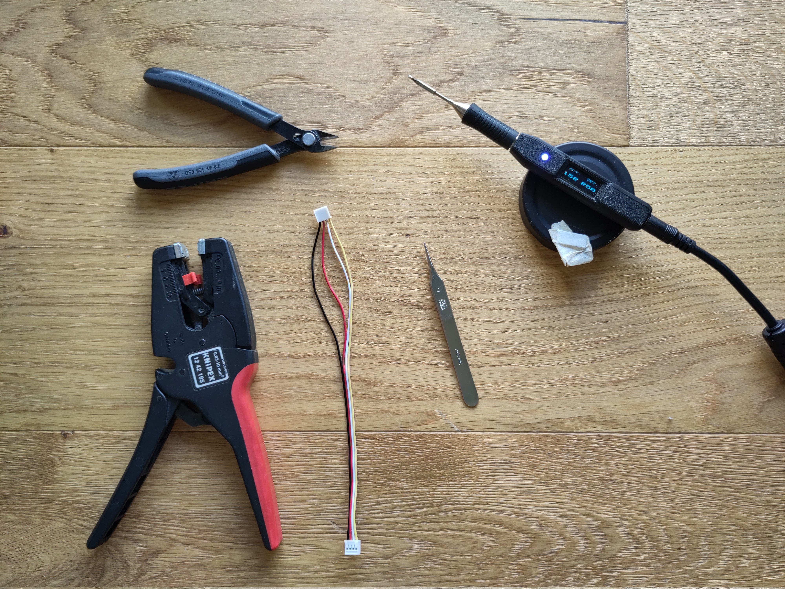
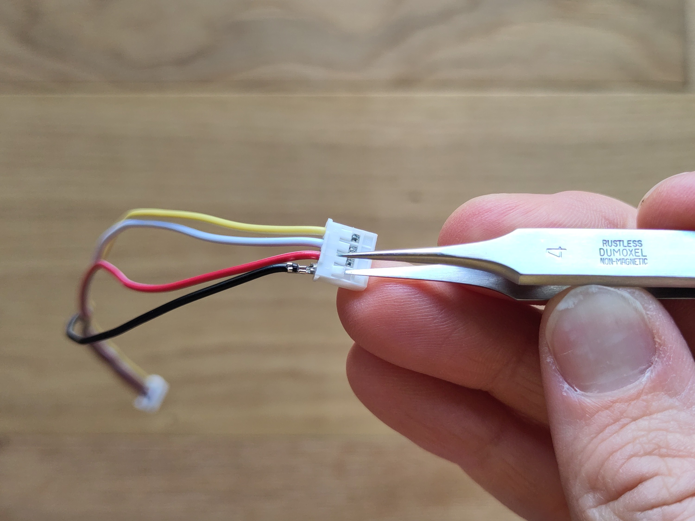
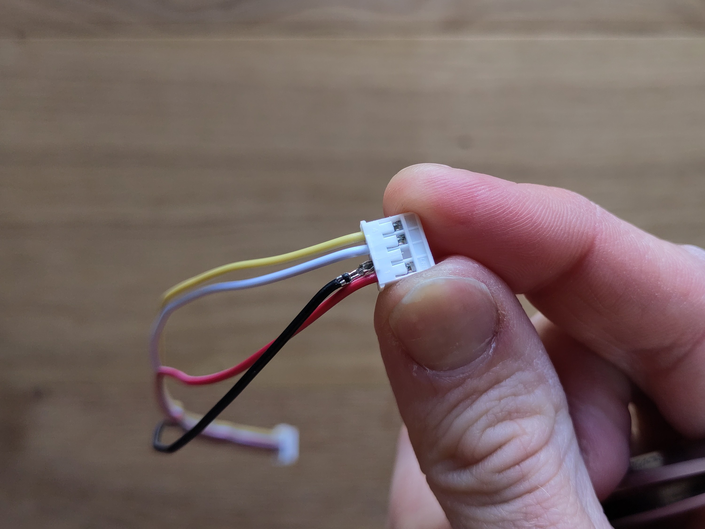
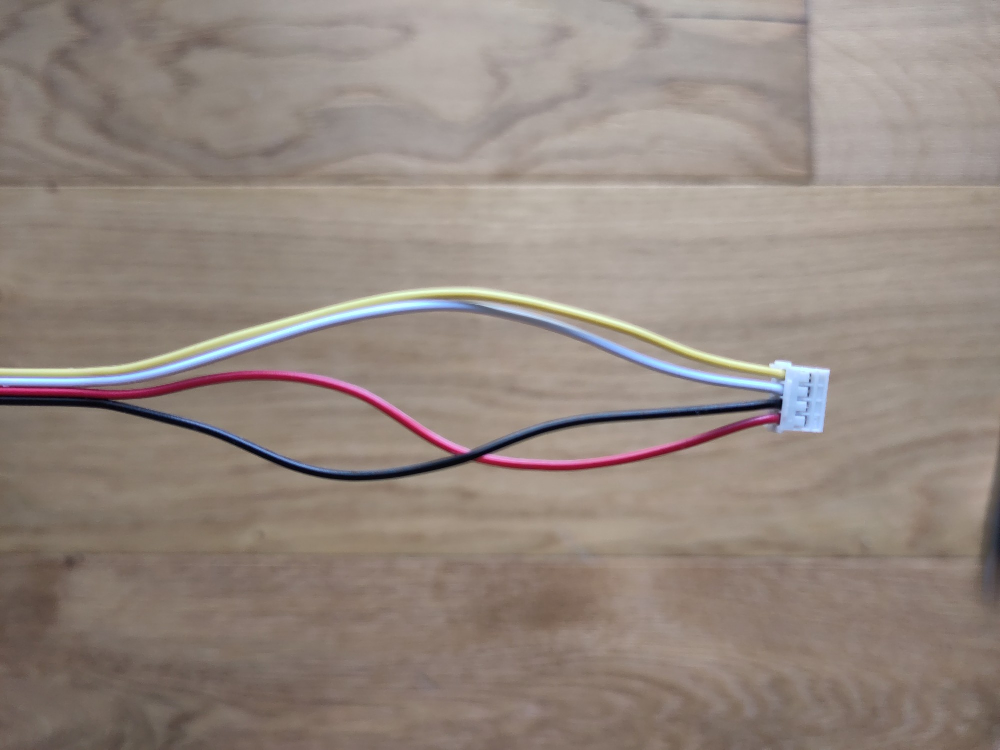
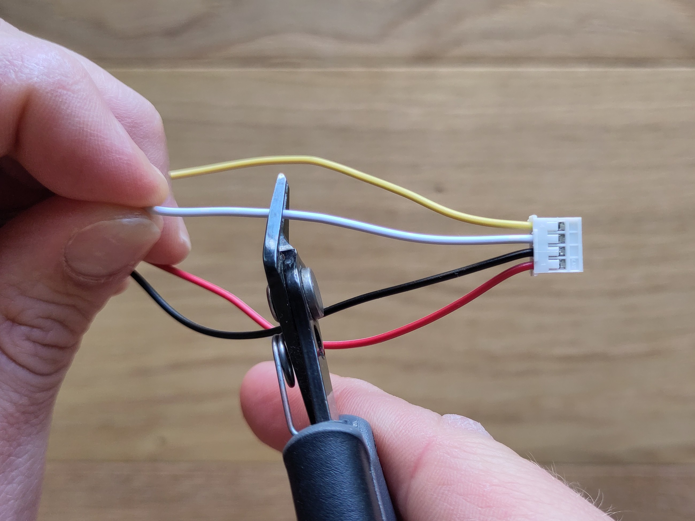
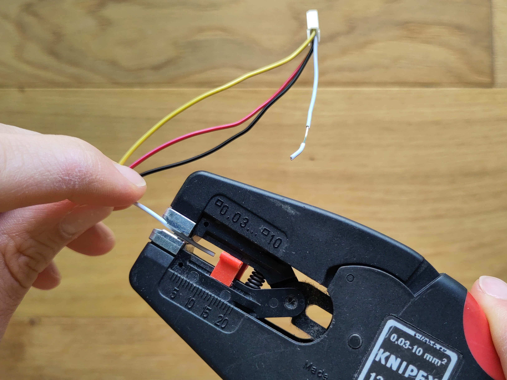
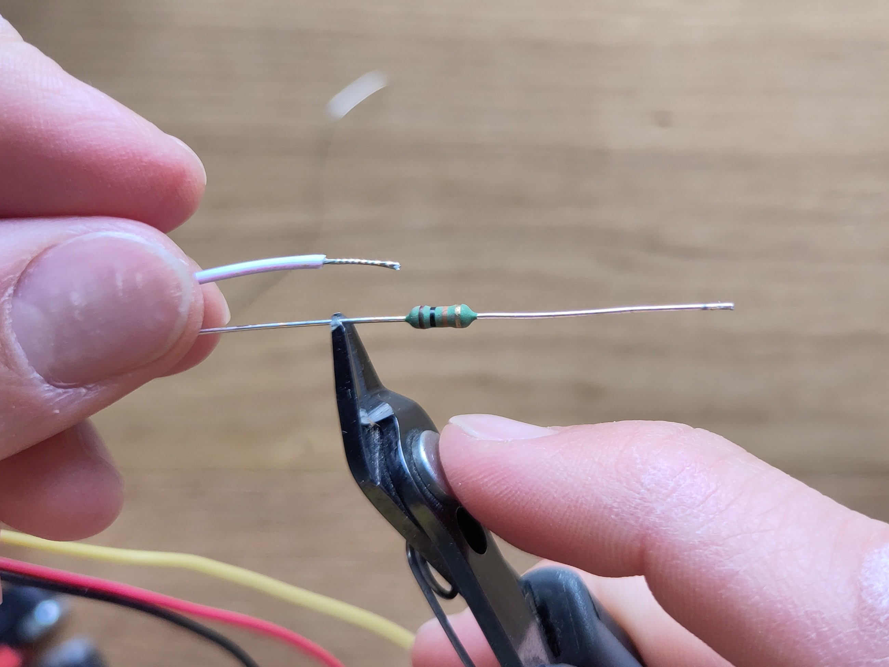
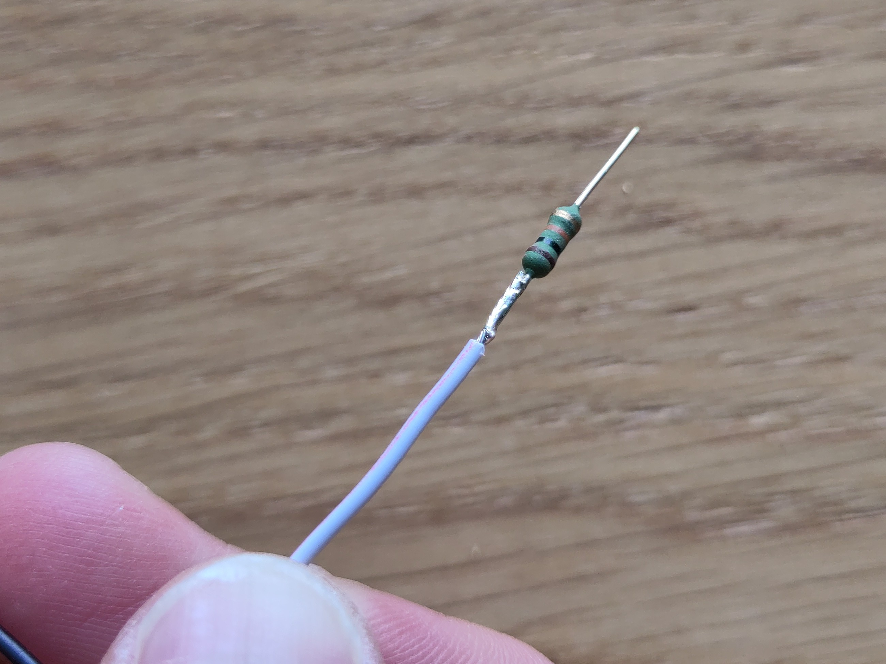
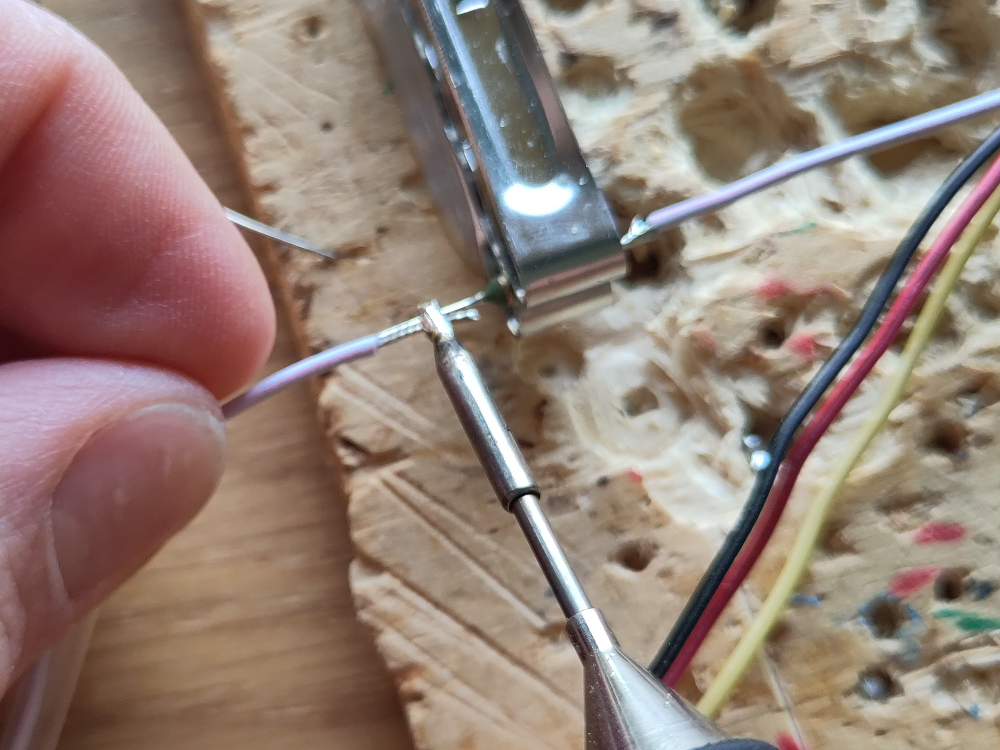
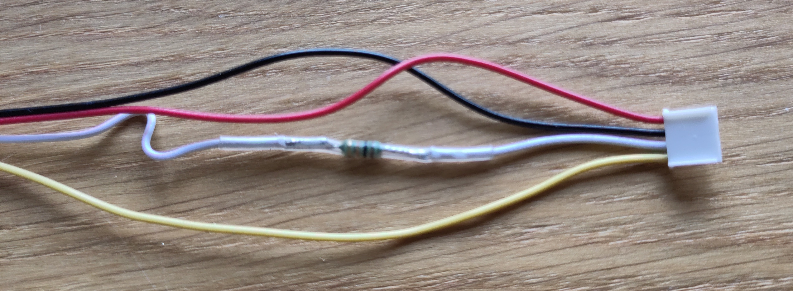

# Adapter Löten

## Benötigte Materialien
<!--   -->

## Pin-Reihenfolge tauschen
<!--  -->

<!--  -->

<!--  -->

## Widerstand einbauen
TX-Leitung (weiß) durchschneiden
<!--  --> 

abisolieren
<!--  -->

10k Widerstand - Beinchen auf Länge kürzen
<!--  -->

Widerstand anlöten
<!--  -->

<!--  -->

noch mit tape oder tesa abkleben. und schon ists fertig :-)
<!--  -->

